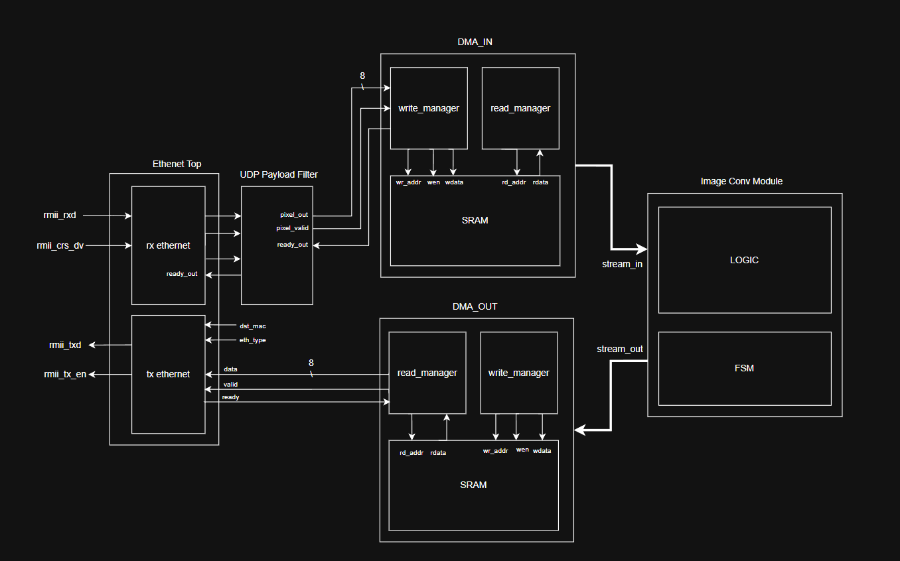
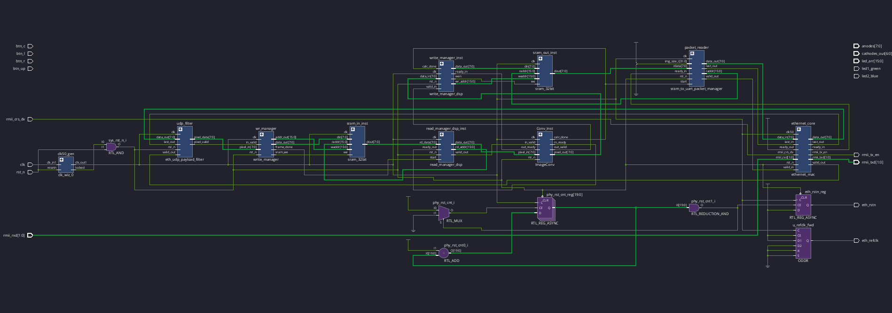
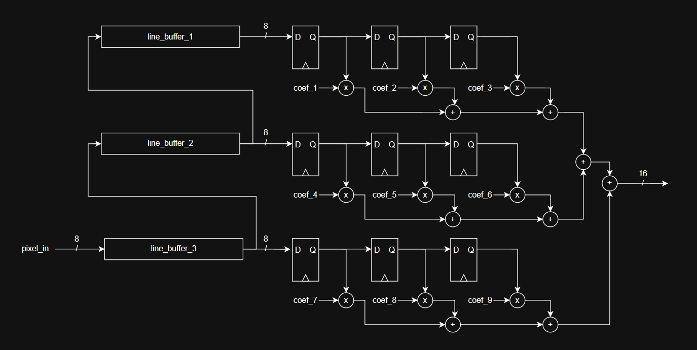
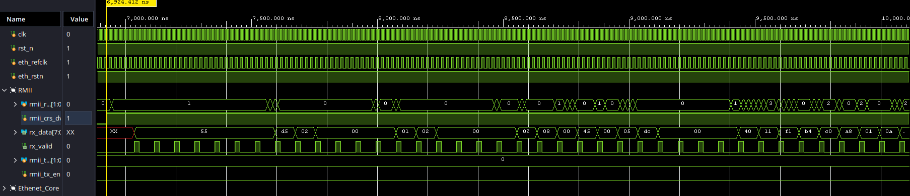

# FPGA Image Processing On a Network

## 1. Top-Level Architecture

* **Clocking & Synchronization:** The entire pipeline operates in a single, synchronous 50 MHz domain (`clk50`) aligned with the RMII Ethernet reference clock.
* **Ethernet MAC & Transport:** Handles physical RMII transmission/reception, preamble parsing, and CRC verification.
* **UDP Payload Filter:** Strips Ethernet/IP/UDP headers on-the-fly and filters incoming packets to extract the raw 8-bit grayscale pixel stream.
* **DMA_IN (Input SRAM Subsystem):** 
  * `write_manager` writes the incoming pixel stream into the input SRAM.
  * Asserts `frame_done` once a complete frame (IMAGE_SIZE^2) is stored.
  * `read_manager_dsp` streams pixels from SRAM into the convolution unit.
* **Image Convolution Unit (`ImageConv`):** Performs real-time 3x3 kernel filtering (Identity, Gaussian, Sharpen, Sobel) selected via on-board push buttons.
* **DMA_OUT (Output SRAM Subsystem):** 
  * `write_manager_dsp` writes processed pixels from the convolution engine into the output SRAM.
  * `packet_reader` streams the stored frame from SRAM directly to the Ethernet MAC TX path upon `calc_done`.
* **Diagnostics:** Drives live frame counters to the 7-segment display and status indicators to LEDs.

## 2. Data Flow

* **Ingress:** Host PC -> RMII (RX) -> Ethernet MAC -> UDP Payload Filter -> Grayscale pixel stream.
* **Buffering & Processing:** write_manager -> Input SRAM -> read_manager_dsp -> ImageConv Engine.
* **Egress:** write_manager_dsp -> Output SRAM -> packet_reader -> Ethernet MAC -> RMII (TX) -> Host PC.

---

## 3. Functional Description

* **1. Reception & Filtering:**
  * Host streams raw 8-bit grayscale pixels over UDP in row-major order.
  * The hardware drops non-matching IP/UDP traffic and strips protocol headers with zero backpressure.
* **2. Frame Storage (Input Stage):**
  * `write_manager` stores incoming bytes sequentially into the input SRAM.
  * Once the frame counter reaches IMAGE_SIZE^2, write access terminates and `frame_done` initiates processing.
* **3. Streaming Kernel Convolution:**
  * `read_manager_dsp` streams stored frame data into `ImageConv` using valid/ready handshaking.
  * The convolution engine uses cascaded line buffers to maintain a continuous 3x3 sliding window.
  * Pixels are multiplied by filter coefficients, summed, normalized via arithmetic shift, clamped to [0, 255], and driven out with valid pulses.
* **4. Dynamic Filter Selection:**
  * On-board push buttons latch the desired kernel profile in real-time (`btn_c`: Identity, `btn_r`: Gaussian, `btn_l`: Sharpen, `btn_up`: Sobel).
* **5. Frame Transmission (Output Stage):**
  * Processed pixels are sequentially buffered into the output SRAM.
  * When `calc_done` pulses, `packet_reader` reads out the output SRAM and streams the processed frame straight into the Ethernet MAC for transmission back to the host.
* **6. Live Telemetry:**
  * Internal hardware counters monitor processed frame counts and output them to the multiplexed 7-segment display.

## Elaborate Design

## Verification

### Eathenet MAC Frame receiving

